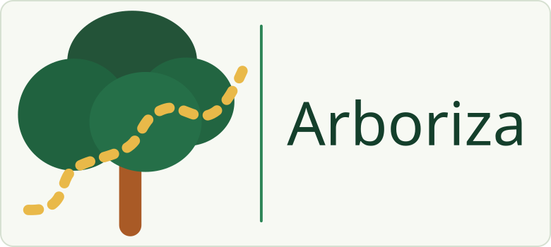

# Arboriza

<p align="center">
  
</p>

**Arboriza é um projeto acadêmico da SEMATEC / Ideathon FATEC 2026**, no tema Mobilidade Urbana e Sustentabilidade. O site organiza imagens aéreas e dados geográficos para mapear possíveis copas de árvores em Araçatuba/SP. A equipe revisa as propostas antes de disponibilizá-las para consulta.

> Protótipo em desenvolvimento. As análises são estimativas, não um inventário confirmado de árvores. A qualidade geral e a cobertura de toda a cidade ainda não foram validadas.

## Abrir e experimentar

### Uso local com dados públicos

Para abrir a interface local, é necessário Git e Node.js 22.22 ou superior. Python 3.12 é necessário somente para o backend. O mapa público pode ser aberto sem conta. Para iniciar a interface:

```powershell
git clone https://github.com/lucasbrasantos/arboriza-sematec-2026.git
cd arboriza-sematec-2026/app/frontend
npm ci
npm run dev
```

Abra <http://127.0.0.1:5173/>. A página inicial e o mapa público abrem sem autenticação. A disponibilidade de dados publicados depende do estado do acervo local; exemplos demonstrativos são identificados na tela.

### Administração local demonstrativa

O backend mantém a autenticação real. Ele **não cria um administrador automaticamente**. Inicie a API conforme o guia [do backend](app/backend/README.md). Em outro terminal PowerShell, crie a conta de demonstração no banco local vazio:

```powershell
cd app/backend
.\.venv\Scripts\python.exe -m arboriza_api.access.demo_admin
```

Na tela `/login`, use:

| Campo | Acesso local de demonstração |
| --- | --- |
| Usuário | `demo` |
| Senha | `ArborizaDemo2026!` |

O comando só cria essa conta se o banco ainda não tiver usuários; ele nunca altera contas existentes. Essas credenciais servem para o clone local, com API vinculada a `127.0.0.1`. Não use essa senha em um site exposto na internet. Cada integrante pode criar um administrador com senha própria usando `python -m arboriza_api.access.bootstrap`.

## O que o protótipo oferece

- **Mapa público:** navegação cartográfica, fontes e resultados publicados quando disponíveis. Dados ilustrativos estão marcados como demonstração.
- **Administração:** acesso da equipe, seleção territorial, execução de análises, revisão, camadas e acervo conforme os fluxos integrados.
- **Transparência:** página pública `/sobre`, com equipe, fontes, uso de IA, bibliotecas e limites.
- **Análise geográfica:** modelos pré-treinados Cambridge e Restor geram propostas de copas. A equipe deve conferir essas propostas antes de usá-las.

## Instalação para desenvolvimento

Os comandos da interface estão em [`app/frontend/README.md`](app/frontend/README.md). Eles permitem executar e compilar o React/TypeScript sem instalar modelos de IA.

O backend do produto está em [`app/backend/README.md`](app/backend/README.md). Ele precisa de Python, ambiente compatível com CUDA/Detectron2, pesos locais e dados geográficos preparados. A venv existente foi criada para a máquina validada e não é portátil. Para outro computador, a instalação e a compilação das dependências nativas precisam seguir as versões documentadas.

Um clone limpo do GitHub permite rodar a interface. Para login e administração, também é preciso preparar e iniciar a API. As análises reais precisam das ortofotos locais e dos pesos Cambridge/Restor; esses arquivos grandes e o ambiente CUDA/Detectron2 compatível não acompanham o repositório. Sem eles, o processamento de imagem não fica disponível. Verifique `/api/health` para conferir a disponibilidade dos dados e modelos.

### Máquina usada nas análises

Os pilotos registrados foram processados em **Windows 10 Pro, AMD Ryzen 5 5600G (6 núcleos / 12 threads), 64 GB de RAM e NVIDIA GeForce RTX 5070 (12 GB de VRAM)**. A pilha Cambridge/Restor foi validada com Python 3.12.10, PyTorch 2.7.1+cu128, torchvision 0.22.1+cu128, CUDA Toolkit 12.8.61 e Detectron2 compilado para essa GPU. Esta é a configuração testada, **não um requisito mínimo**: os mínimos de RAM/VRAM não foram medidos. A GPU é necessária para executar inferência no backend atual; navegar no site público não exige GPU. Veja o [guia de instalação dos modelos de IA](app/backend/INSTALACAO_MODELOS_IA.md).

## Dados e interpretação

| Dado | Origem e uso |
| --- | --- |
| Ortofotos RGB | IGC-SP / DataGEO, coleção 2023/2024, resolução declarada de 25 cm/pixel. Imagens não são em tempo real. [Metadados](https://datageo.ambiente.sp.gov.br/geoportal/catalog/search/resource/details.page?uuid=%7B7665C108-A2FF-49D8-A1EF-A6968BA6016A%7D). |
| Setores censitários | IBGE, Censo 2022. A malha preparada contém 499 setores urbanos de Araçatuba; isso não significa que todos foram analisados. |
| Eixos viários | OpenStreetMap. Os indicadores de copas/trechos são calculados pelo Arboriza. [Créditos OSM](https://www.openstreetmap.org/copyright). |
| Exemplos de interface | Pontos, quantidades, trechos e prioridades demonstrativos são simulados, identificados como tal e não representam resultados reais da cidade. |

Um ponto representa uma proposta associada a uma copa, não necessariamente a posição do tronco. Grupos e complementos pendentes têm significados diferentes. Densidade de pontos não equivale à cobertura de copas. A regra 3-30-300 é apresentada como referência educativa, sem certificação dos seus componentes.

## Originalidade e uso de IA

O Arboriza foi desenvolvido pela equipe no contexto do Ideathon FATEC 2026. Os integrantes definiram o fluxo de análise por setor, integraram os modelos pré-treinados ao mapa e revisam as marcações.

ChatGPT e Codex apoiaram a montagem dos slides e tarefas de desenvolvimento de software. OpenAI ImageGen gerou a ilustração botânica da abertura. Restor e Cambridge são modelos pré-treinados que geram propostas de copas para conferência; a equipe não treinou esses pesos do zero. Os integrantes selecionam e revisam as contribuições. Veja a declaração e os detalhes na página Sobre (`/sobre`).

## Bibliotecas e créditos

Interface: React, TypeScript, Vite, React Router, Leaflet / React Leaflet, Leaflet.heat, Motion, Radix UI, Lucide e Manrope. Backend e análise: Python, FastAPI, Pydantic, PyTorch, Detectron2 / Detectree2, Rasterio, PyProj e Shapely. O frontend partiu do template React oficial do Vite. Modelos, bibliotecas, mapas e recursos visuais mantêm suas licenças e atribuições. Confira [`app/frontend/package.json`](app/frontend/package.json), `app/backend/requirements/` e a página Sobre (`/sobre`).

## Limitações conhecidas e próximos passos

- A qualidade global das detecções ainda não foi medida com uma referência completa revisada.
- O processamento depende de dados e pesos locais, GPU/CUDA e componentes nativos compatíveis.
- Uma análise nova requer revisão humana; não representa autorização ou indicação automática de plantio.
- Diagnóstico de rua não confirma ausência de árvores nem substitui vistoria.
- A cobertura completa e atualizada de Araçatuba ainda precisa de processamento e revisão.
- Próximos passos: concluir acervo e publicação pública, validar fluxos com usuários, expandir a cobertura e avaliar o desempenho com volume representativo.

A interface inclui navegação por teclado, link para pular ao conteúdo e suporte à preferência de movimento reduzido. Contraste, zoom de texto e fluxos completos ainda precisam de conferência na versão publicada antes de afirmar conformidade de acessibilidade.

## Documentação

- [Instalação da aplicação](app/README.md)
- [Frontend React/TypeScript](app/frontend/README.md)
- [Backend FastAPI](app/backend/README.md)
- [Instalação dos modelos de análise](app/backend/INSTALACAO_MODELOS_IA.md)
- [Escopo funcional](docs/ESCOPO_WEBSITE_PRIMEIRA_ENTREGA.md)
- [Plano de integração](docs/PLANO_BACKEND_INTEGRACAO.md)
- [Levantamento da entrega Ideathon](docs/LEVANTAMENTO_ENTREGA_IDEATHON.md)
- [Briefing de apresentação](docs/apresentacao/ARBORIZA_BRIEFING_APRESENTACAO.md)
