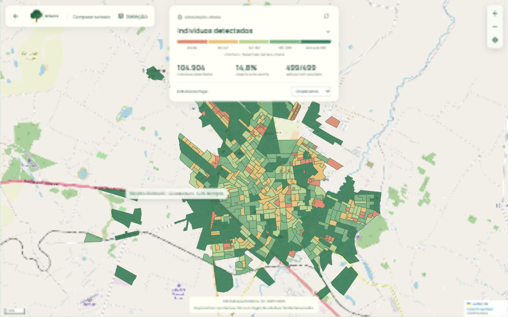
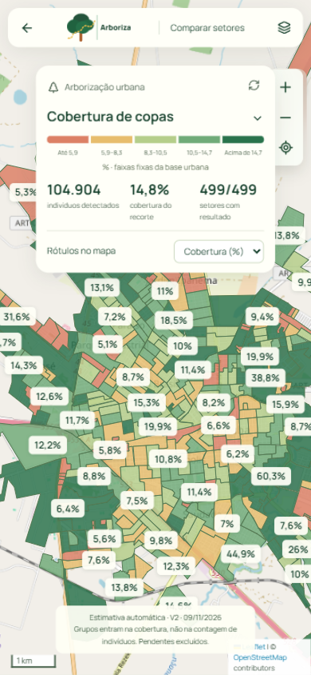

# Entrega da base urbana V2 — 09/11/2026

Base dos **499 setores urbanos de Araçatuba** concluída, salva, publicada e conferida no navegador com dados reais. O mapa abre em `/mapa/comparar`; usa o snapshot versionado de 1,71 MB, sem repetir inferência e sem carregar as geometrias detalhadas das árvores.

| Resultado | Valor |
|---|---:|
| Área analisada | 77,992 km² |
| Indivíduos detectados | 104.904 |
| Grupos de copas | 11.653 |
| Complementos pendentes | 21,521 |
| Cobertura estimada | 14,808% |
| Janelas processadas | 29.882 |
| Tempo ativo de processamento | 88.4 min |

O tempo de relógio incluiu pausas de atualização e a recuperação de um bloqueio transitório de arquivo do Windows. Os checkpoints permitiram retomar sem refazer janelas. O pipeline sobrepõe leitura, inferência e escrita; os modelos, pixels, resolução e critérios da fusão foram mantidos.

## Validação

- Contagens e áreas comparadas com a fusão original em testes; piloto real reproduziu 125 indivíduos e 20 grupos.
- Arquivos completos conferidos: integridade SQLite, geometrias válidas, códigos dos 499 setores, contagens consistentes e camadas GeoPackage/GeoJSON completas.
- 75 testes Python, lint e build/TypeScript passaram. Foi acrescentado teste de leitura do snapshot sem resultados locais.
- Navegador: base inteira com 104.904 indivíduos; retirar o setor `350280405000001` (123 indivíduos na consolidação global) alterou o total para 104.781; recolocar restaurou 104.904. Métricas, rótulos de cobertura e layout celular conferidos, sem erros de console.
- Números de setor podem diferir de análises isoladas: a consolidação global resolve duplicações e atribuições nas fronteiras com contexto da cidade toda.

## Recursos e arquivos

O acompanhamento registrou GPU máxima de 54,57 °C, pico de VRAM de 10.890 MiB/12.227 MiB, CPU amostrada até 72,5%, pelo menos 47,82 GiB de RAM disponível e 21,89 GiB livres em disco. Temperatura da CPU não estava disponível nessa instrumentação. Não houve pausa preventiva por recursos.

| Arquivo | Tamanho decimal |
|---|---:|
| Pontos GeoJSON | 47,10 MB |
| Copas GeoJSON | 533,27 MB |
| GeoPackage | 268,01 MB |
| Pontos comprimidos | 5,71 MB |
| Copas comprimidas | 153,60 MB |
| Snapshot de setores | 1,71 MB |

[Release com os arquivos completos](https://github.com/lucasbrasantos/arboriza-sematec-2026/releases/tag/base-urbana-20261109T031948-ca7410d3). Código e snapshot estão na branch `app-front`; o commit inicial da funcionalidade é `9189254`.

## Capturas com os dados reais

## Limites de interpretação

São detecções automáticas preliminares. Grupos não equivalem a indivíduos; complementos pendentes não entram na cobertura. Os pontos representam copas, não localização confirmada de troncos. Quantidade absoluta favorece setores maiores; densidade e cobertura são opções adicionais. As classes são relativas à distribuição da base urbana e não definem meta de adequação ou cumprimento de 3-30-300.
