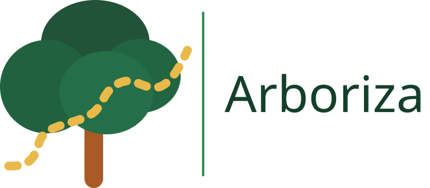
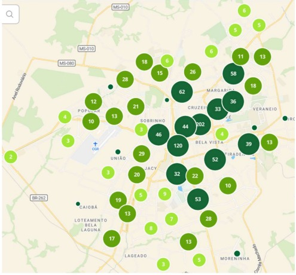
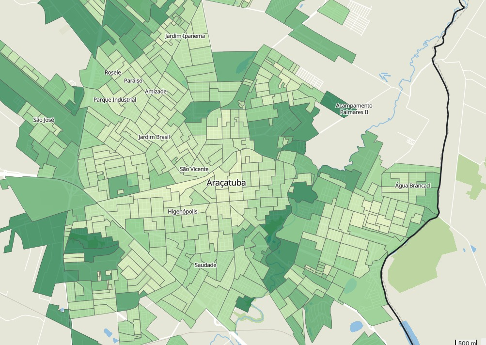

# Arboriza

### Inteligência geográfica para conhecer e planejar a arborização urbana



**Briefing completo de apoio à apresentação final · SEMATEC / Ideathon FATEC 2026**  
**Tema:** Mobilidade Urbana e Sustentabilidade · **Foco inicial:** Araçatuba/SP  
**Atualização:** 08/11/2026 · **Idioma da apresentação:** português

> Este material reúne a visão do produto, as decisões da equipe, a implementação em andamento e as evidências dos experimentos. Serve como base para os slides e para a fala. Os resultados de pilotos não representam um inventário completo de Araçatuba. Acervo de resultados e consulta pública final estão em desenvolvimento; conferir sua conclusão antes da apresentação.

## Guia de leitura

1. Mensagem central e problema
2. Públicos, objetivo e limites
3. Produto e funcionalidades
4. Fluxo completo
5. Imagens e resolução
6. Território e setores censitários
7. Modelos de inteligência artificial
8. Resultados e desempenho
9. Arquitetura e requisitos de execução
10. Diagnóstico, indicadores e regra 3-30-300
11. Estado atual e entregas futuras
12. Identidade visual
13. Roteiro sugerido de slides
14. Perguntas prováveis
15. Fontes e evidências

## 1. Mensagem central e problema

**Descrição em uma frase:** O Arboriza transforma imagens aéreas e dados geográficos em camadas de possíveis copas de árvores, que a equipe pode revisar e disponibilizar em um mapa para apoiar a análise da arborização urbana.

**Fala de abertura sugerida:** “Onde estão as árvores da cidade e quais trechos merecem mais atenção? O Arboriza reúne imagens aéreas, inteligência artificial e mapas para ajudar a responder essa pergunta. A equipe analisa uma região, revisa os resultados e disponibiliza informações para consulta. Começamos por áreas de Araçatuba, com a proposta de ampliar gradualmente a cobertura urbana.”

O projeto parte da necessidade de organizar informações sobre a distribuição da arborização, especialmente em ruas, calçadas e espaços usados por pedestres. Árvores e áreas verdes se relacionam com conforto ambiental e qualidade dos espaços urbanos; entender sua distribuição pode apoiar a avaliação de lugares pouco arborizados. Não foi medido pelo projeto um efeito sobre temperatura, saúde ou mobilidade, nem um número de árvores que deveriam ser plantadas.

A contribuição pretendida é diminuir o trabalho de localizar visualmente possíveis copas em grandes áreas e reunir os resultados em um fluxo revisável. A IA propõe; a equipe interpreta e revisa. O sistema organiza evidências para avaliação técnica e planejamento.

## 2. Objetivos, públicos e limites

### Objetivo principal

Mapear possíveis árvores e copas, compreender sua distribuição e apoiar a identificação de ruas ou trechos com baixa arborização para avaliação pela equipe.

### Objetivos específicos

- Selecionar áreas de estudo por setores censitários oficiais.
- Processar imagens aéreas e produzir pontos e, nos perfis compatíveis, polígonos de copas.
- Organizar resultados em camadas com origem e parâmetros rastreáveis.
- Permitir revisão, importação, exportação e organização dos materiais produzidos.
- Publicar resultados escolhidos pela equipe para consulta pública.
- Evoluir para comparação territorial e apoio à priorização de avaliações.

### Quem utiliza

| Público | Papel no produto |
| --- | --- |
| Equipe do projeto / equipe técnica | Seleciona território, executa análises, importa dados, revisa, salva e publica. |
| Moradores e interessados | Consultam os materiais publicados, exploram o mapa e conhecem a proposta. |
| Gestão ambiental, planejamento e mobilidade | Público institucional potencial para avaliar o uso das informações. Não há parceria ou implantação municipal confirmada neste briefing. |

O acesso administrativo é exclusivo da equipe. Não haverá cadastro público para executar análises nesta entrega; novos usuários serão criados internamente. Isso também permite controlar o uso do processamento.

A primeira entrega trabalha com áreas piloto. A expansão planejada cobre o conjunto dos setores **urbanos** de Araçatuba, incluindo núcleos isolados presentes na malha. Essa delimitação não representa todo o território rural municipal.

## 3. O website: três áreas principais

### Início

Apresenta o problema, a proposta, como o Arboriza funciona, o acesso ao mapa e o conteúdo educativo da regra 3-30-300. A identidade usa verdes, formas botânicas, imagens de apoio e animações moderadas. A página inicial comunica o projeto; fotografias decorativas e demonstrações não devem ser apresentadas como detecções reais.

### Mapa público

É o espaço de consulta aos resultados publicados. A composição prioriza o mapa em tela ampla, com navegação compacta e painel flutuante recolhível. O visitante deverá escolher um resultado pelo nome e prévia, carregar suas camadas e consultar detalhes e fontes.

Estão previstos pontos, limites, visualização de densidade e informações de diagnóstico quando disponíveis e revisadas. Base cartográfica e visualização dos dados são escolhas distintas: trocar ruas por imagem aérea muda o fundo; escolher pontos ou densidade muda a apresentação dos resultados.

O público recebe material preparado pela equipe. Não executa o detector nem altera os dados administrativos. Áreas sem publicação devem ser identificadas como sem dados disponíveis, em vez de receber contagem zero.

### Administração

Após o login da equipe, o portal oferece dois acessos principais: **mapa administrativo** e **acervo de análises/importações**.

O mapa administrativo funciona como uma bancada de trabalho: mapa ao fundo, lateral esquerda por contexto, propriedades à direita e ferramentas flutuantes na parte inferior. A composição aprovada é somente a compacta, com painéis recolhíveis. Os contextos organizam território, configuração de análise, revisão e camadas.

O gerenciador de camadas reúne busca, organização por execução, paginação, ativação, visibilidade e enquadramento. Uma camada ativa pode estar oculta; várias camadas podem aparecer simultaneamente, enquanto a edição deve ter um alvo claro. Propriedades descrevem a origem, os itens e a geometria de referência.

Durante a análise, o acompanhamento apresenta etapas e bloqueia as ações do espaço de trabalho para evitar conflitos. O tempo decorrido pode ser mostrado; porcentagens ou previsões não devem ser inventadas quando o servidor não as fornece.

O acervo organiza cada análise ou importação em um registro próprio, com nome, prévia, abrangência e situação de revisão/publicação. Salvar, exportar e publicar são ações diferentes. O acervo de **resultados** também é diferente do acervo local de **imagens aéreas**.

## 4. Fluxo completo do produto

```text
Equipe entra no sistema
    → escolhe os setores / área de estudo
    → confere imagens disponíveis, modelo e parâmetros
    → executa análise OU importa resultado compatível
    → recebe camadas de pontos e copas, conforme o perfil
    → revisa os dados e consulta diagnósticos
    → salva um registro no acervo
    → escolhe o material para publicação
    → visitante seleciona esse resultado no mapa público
```

### Regras de publicação definidas

- Uma análise nova não deve alterar automaticamente o que está publicado.
- Só um registro pode ficar publicado para a mesma combinação exata de setores, considerada a versão territorial.
- Uma análise de X e outra de X + Y podem coexistir, porque são abrangências diferentes.
- Resultados anteriores são preservados no histórico administrativo.
- A soma dos pontos de publicações sobrepostas pode conter duplicações; não representa automaticamente um total único da cidade.

O tratamento de importações sem vínculo territorial e os detalhes da substituição de publicações exigem regras explícitas no backend.

## 5. De onde vêm as imagens e por que usar 25 cm/pixel

### Fonte principal

As análises usam ortofotos do IGC-SP disponibilizadas pelo DataGEO, na camada `ORTOFOTOS_SP_2023_2024`. O catálogo oficial declara imagens em cor natural RGB e resolução espacial de 25 cm. O período 2023/2024 descreve o levantamento da coleção; a data exata de captura de cada local deve ser conferida nos metadados disponíveis. Não apresentar o mapa como uma imagem em tempo real. [Metadados oficiais IGC/DataGEO](https://datageo.ambiente.sp.gov.br/geoportal/catalog/search/resource/details.page?uuid=%7B7665C108-A2FF-49D8-A1EF-A6968BA6016A%7D).

Uma ortofoto é uma imagem aérea corrigida geometricamente para permitir sua relação com posições no mapa. No projeto, as imagens foram obtidas por requisições WMS e organizadas em arquivos georreferenciados; isso não equivale ao download dos GeoTIFFs originais do aerolevantamento.

### Explicação simples da resolução

25 cm/pixel significa que cada pixel representa aproximadamente 25 cm no solo. Uma copa de 5 metros ocupa cerca de 20 pixels de diâmetro nessa resolução. Em uma imagem de 10 metros/pixel, ela ocuparia apenas meio pixel. Esse cálculo ilustra o detalhe disponível; não garante a detecção de toda árvore.

**Formulação recomendada para o slide:** “Utilizamos imagens de alta resolução, a 25 cm/pixel, para preservar detalhes das copas urbanas.”

Evitar afirmar que qualquer detector exige universalmente exatamente 25 cm. Essa é a fonte e a resolução de trabalho adotadas e verificadas no projeto. Modelo, escala de entrada, sombras, qualidade da imagem e tamanho das copas também afetam a detecção. Ampliar uma imagem por interpolação não cria novos detalhes capturados.

Sentinel-2 foi estudado como complemento regional para vegetação e índices espectrais, mas sua resolução de 10 m nas bandas relevantes não substitui as ortofotos para pequenas copas de calçada. NIR e NDVI não são filtros de saturação RGB; dependeriam de bandas e fluxo próprios. Não fazem parte da inferência RGB atual.

### Acervo local de imagens

O planejamento documentado para cobrir os 499 setores urbanos usa **523 blocos de 500 × 500 m**, com 25 m de contexto territorial. Cada bloco é solicitado em 2000 × 2000 pixels a 0,25 m/pixel, na projeção métrica EPSG:31982. Esses blocos são unidades de aquisição e cache, distintas dos setores censitários.

Os arquivos guardam georreferência, máscara de validade e procedência. A captura pode ser retomada e confere arquivos existentes. Os 523 blocos equivalem a aproximadamente **6,28 GB de RGB bruto**, antes de compressão, máscaras e pirâmides de visualização. Esse número não é o tamanho final do acervo em disco nem comprova sua captura completa.

O backend lê as partes necessárias de cada imagem e utiliza caches. O navegador recebe camadas e tiles, em vez de carregar o mosaico inteiro da cidade. Conferir cobertura e integridade do acervo antes de afirmar que uma região inteira pode ser analisada.

## 6. Como foi feita a divisão territorial

Usamos a **Malha de Setores Censitários definitiva do Censo 2022, do IBGE**. O script de preparação obtém a malha de São Paulo, filtra o município de Araçatuba (`3502804`) e a situação `Urbana`, preserva os códigos e registra a origem e o hash do arquivo.

O recorte preparado contém **499 setores urbanos**. As geometrias são transformadas para WGS84/EPSG:4326 para intercâmbio e exibição no mapa. Cálculos que exigem metros e áreas usam projeção métrica apropriada; o motor utiliza EPSG:31982.

A seleção pode ser feita por código ou clique. No protótipo também existem retângulo e desenho livre que selecionam setores inteiros com interseção de área positiva. As geometrias permitem enquadrar, unir a área e vincular a análise à versão da malha.

**Duas segmentações diferentes:** os setores dividem o território da cidade; a segmentação de imagem delimita as copas previstas pela IA. Uma não é produzida pela outra.

Setores não são necessariamente bairros, quarteirões ou divisões administrativas. A união geométrica urbana documentada é de aproximadamente **77,99 km²**; a soma dos valores declarados em `AREA_KM2` pode diferir. Usar o mesmo método ao comparar áreas e identificar a medida empregada. A malha estatística de 2022 não certifica o perímetro urbano legal atual.

## 7. Modelos e evolução da inteligência artificial

O trabalho utiliza pesos pré-treinados. **Não houve treinamento de um modelo próprio do zero** nas entregas descritas. A contribuição da equipe está na seleção, integração, preparação geográfica, comparação, fusão, revisão e apresentação das saídas.

### Investigação anterior: HQ-SAM

Antes do protótipo de pontos, um laboratório separado utilizou HQ-SAM ViT-H, com testes manuais e automáticos de segmentação. A aprendizagem principal foi distinguir **delimitar uma região da imagem** de **identificá-la como árvore**: uma máscara bem desenhada pode representar outro objeto. Essa investigação ajudou a redirecionar o produto para detecções geográficas revisáveis, sem exigir a edição perfeita de contornos em todo caso.

HQ-SAM não integra automaticamente o perfil Controle nem a fusão v2. Detectree2 flexi, CanopyRS DINO/Swin-L e SAM 3 também foram discutidos em planos experimentais, mas as fontes consultadas não sustentam apresentá-los como modelos integrados ou comparações concluídas. Não houve pipeline DeepForest → HQ-SAM validado nas entregas descritas. Evidência histórica: `docs/RESUMO_DECISOES_ESCOPO_FASE_2.md`, seções 4–5, e `docs/PLANO_RODADA_03_MODELOS_E_LIMPEZA.md`.

| Modelo / família | Função no Arboriza | Estado e observações |
| --- | --- | --- |
| DeepForest 2.1.0, `weecology/deepforest-tree` | Experimento inicial de detecção por caixas e conversão dos centros em pontos. | Histórico de investigação. Apresentou omissões e não foi estabelecido como vencedor para a cidade. |
| Detectree2 Cambridge | Modelo urbano de segmentação de copas usado pelo perfil Controle. | Peso `urban_trees_Cambridge_20230630.pth`; Mask R-CNN com backbone R101/FPN, executado com Detectron2. |
| Restor TCD, `restor/tcd-mask-rcnn-r50` | Base do perfil v2 para propostas individuais e grupos de copas. | Mask R-CNN R50. Atua em conjunto com Cambridge no perfil experimental de fusão. |
| Restor + Cambridge — modelo v2 | Combina propostas e gera pontos e polígonos vinculados. | Separa indivíduos, grupos e complementos pendentes. Já experimentado com dados locais; sujeito a revisão e validação. |

Detectree2 e DeepForest são ferramentas/famílias de visão computacional; Detectron2 é a infraestrutura usada pelo modelo de segmentação. Controle, multiescala e fusão são perfis do processamento, não necessariamente redes novas treinadas pela equipe.

### Controle Cambridge

O piloto usa janelas de aproximadamente 200 m e corte de score padrão 0,15. A rede prevê máscaras/caixas, e o fluxo gera pontos geográficos representativos. Cortes e agregação influenciam a quantidade final de propostas. O score ordena a confiança interna do detector; **0,15 não significa 15% de probabilidade de ser árvore**.

O perfil multiescala experimental combina janelas de 200 m e 100 m. As menores ampliam a copa na entrada da rede e exigem mais chamadas, mas não aumentam a resolução real da imagem. Sobreposição e supressão de duplicações precisam de conferência para não repetir ou eliminar copas.

### Modelo v2: como a fusão funciona

1. Ler as imagens locais válidas a 25 cm/pixel em janelas limitadas.
2. Executar Restor com janelas de 512 pixels, ampliação de entrada de 2,5× e corte 0,50; executar Cambridge nas escalas de 200 e 100 m.
3. Transformar máscaras em polígonos geográficos e tratar sobreposições entre janelas.
4. Cruzar as propostas dos dois modelos, preservando sua origem e parâmetros.
5. Manter Restor como base; propostas exclusivas de Cambridge viram complementos pendentes.
6. Recortar pela área selecionada e gerar ponto representativo e polígono vinculados pelo mesmo ID.

| Saída | Interpretação |
| --- | --- |
| Individuais | Propostas classificadas pelo modelo como copas individuais, sujeitas a confirmação. |
| Grupos | Conjuntos de copas que não devem ser somados como se cada grupo fosse uma árvore individual. |
| Complementos | Propostas Cambridge pendentes de revisão, separadas da cobertura operacional. |
| Polígonos de copas | Área prevista das copas, com vínculo aos pontos. |

O ponto representa a copa, não a posição precisa do tronco. Na revisão do v2, excluir uma proposta deve tratar ponto e polígono de forma coerente; mover o ponto sozinho não deve ser apresentado como correção da geometria da copa.

A cobertura operacional é calculada pela **união** das copas individuais e grupos adotados como base, recortada pela seleção e dividida pela área selecionada. Sobreposições não são somadas e complementos pendentes ficam fora. É uma estimativa automática, distinta de cobertura confirmada pela equipe.

### Pesos e licenças

O manifesto Cambridge registra peso de 503.062.799 bytes, procedência Zenodo e licença CC BY 4.0. Detectree2 declara licença MIT para o código. O modelo Restor consultado é identificado como CC BY-NC; usos fora do contexto acadêmico precisam considerar as condições aplicáveis aos pesos. Código e pesos podem ter licenças diferentes. [Detectree2](https://github.com/PatBall1/detectree2) · [Pesos Cambridge](https://zenodo.org/records/15863800) · [Restor TCD](https://huggingface.co/restor/tcd-mask-rcnn-r50).

## 8. Resultados documentados e desempenho

### O que os números demonstram

As medições abaixo provam a execução do pipeline nos pilotos registrados. Elas não medem precisão geral, não são SLA e não permitem estimar o tempo da cidade inteira multiplicando diretamente um recorte. Aquecimento da GPU, carga dos modelos, rede, cache e conteúdo da imagem afetam os tempos.

| Experimento registrado | Resultado observado | Tempo / condição | Evidência |
| --- | --- | --- | --- |
| DeepForest, Centro, janela 400 px, corte 0,50 | 3 candidatos | 1,088 s de inferência; carga/validação separadas. | `EXPERIMENTO.md`, 05/11. |
| Cambridge Controle, Centro e Centro-norte, corte 0,15 | 33 e 12 propostas | Centro 17,82 s; Centro-norte 0,37 s. Primeira chamada concentrou 17,46 s. | `EXPERIMENTO_CAMBRIDGE.md`, 05/11. |
| v2, amostra de 512 × 512 pixels do entorno da igreja | 43 propostas individuais, 8 grupos e 3 complementos; 19 janelas | 6,225 s após carregar modelos; repetição com cache completo: 0,607 s. | `FUSAO_COPAS.md`, 07/11. |
| v2, setor `350280405000005` | 208 propostas individuais, 14 grupos e 17 complementos; 86 janelas | 19,552 s após carregar os modelos; cobertura operacional preliminar de 6,21%. | `FUSAO_COPAS.md`, 07/11. |

Os ensaios usam configurações e imagens diferentes. A tabela é um histórico ilustrativo; **não comparar as quantidades como uma competição direta entre modelos**. O ganho com cache significa reaproveitamento de processamento, não que toda área nova terá esse tempo.

No piloto Cambridge, o pico do PyTorch foi de aproximadamente 567 MiB alocados e 856 MiB reservados. Isso não inclui toda a memória da GPU e do sistema. A memória conjunta do perfil v2 não está estabelecida nesses números.

### Qualidade: o que já se sabe

Foram observadas omissões, propostas sobre construções e casos de sobreposição/agrupamento. Cambridge recuperou uma região de copa escura que o controle DeepForest não havia proposto; isso é um caso observado, não prova de superioridade geral.

As marcações manuais de estudo passaram por versões e critérios diferentes, incluindo outros verdes e múltiplos cliques em conjuntos. Proximidade entre ponto manual e automático, quantidade semelhante de pontos e cobertura de cliques por máscaras não bastam para declarar precisão ou recall. Uma avaliação válida requer referência revisada e áreas de teste adequadas.

**Frase segura para a apresentação:** “Já executamos análises reais e produzimos camadas georreferenciadas; a qualidade das detecções continua em revisão, e a cobertura municipal completa é uma etapa de expansão.”

## 9. Arquitetura e requisitos

```text
Navegador — React + TypeScript + Leaflet
                 ↓ API HTTP
Backend — Python + FastAPI
    ├── acesso da equipe e sessão
    ├── território, execuções e resultados
    ├── motor de geoprocessamento e IA / CUDA
    ├── SQLite para metadados
    └── arquivos locais: imagens, pesos, caches e GeoJSON

Fontes: IGC/DataGEO · IBGE · OpenStreetMap
```

A implementação prioriza organização por funcionalidades e separação simples entre apresentação, contratos, processamento e armazenamento. O site está em `app/frontend`; a API está em `app/backend`; `prototipo-01` preserva o laboratório e o histórico dos experimentos. O reaproveitamento precisa adaptar caminhos, acesso e persistência ao produto.

React e TypeScript organizam a interface tipada. Vite apoia desenvolvimento/build; React Router cuida da navegação; Leaflet e React Leaflet exibem o mapa; Leaflet.heat apresenta concentração de pontos. Motion apoia animações e Manrope é a fonte da identidade.

Python permite aproveitar o ecossistema de visão computacional e geoprocessamento. FastAPI fornece os contratos HTTP. Rasterio trata rasters, Shapely trata geometria e PyProj transforma coordenadas. SQLite organiza metadados locais; arquivos grandes ficam no armazenamento referenciado, com necessidade de backup consistente.

### O visitante precisa de uma placa de vídeo?

Não para consultar o mapa. A inferência pesada roda no computador/servidor da equipe. O navegador recebe os resultados; a experiência pública depende de conexão, volume carregado e capacidade de renderização do dispositivo.

### Configuração comprovada e mínimos

| Componente | Informação sustentada pelos registros |
| --- | --- |
| GPU dos pilotos | NVIDIA RTX 5070, 12 GB, em Windows 10. É a máquina validada, não requisito mínimo comprovado. |
| Cambridge / Restor | Adaptadores atuais exigem CUDA; não há fallback automático validado para CPU ou AMD. A execução conjunta demanda conferência própria de memória. |
| Ambiente Cambridge / Restor documentado | Python 3.12.10; PyTorch 2.7.1+cu128; torchvision 0.22.1+cu128; Detectron2 compilado para o ambiente Windows/CUDA utilizado. |
| DeepForest histórico | DeepForest 2.1.0 e PyTorch 2.10.0+cu128, em ambiente separado do Detectree2. Não misturar as listas de dependências. |
| Desenvolvimento frontend | Node ≥ 22.22.0 declarado no projeto; React, TypeScript e ferramentas de build. |
| Imagens e disco | Dimensionar para ortofotos, modelos, resultados e caches; o tamanho bruto das imagens planejadas não inclui todo o armazenamento necessário. |
| RAM, CPU e VRAM mínimas por modelo | Não foram estabelecidas por um estudo controlado de configuração mínima. Não preencher esses campos com números estimados como se fossem testes. |

A instalação Detectron2 no Windows exigiu compilação compatível com a GPU e CUDA; a combinação local validada não garante portabilidade da venv para outra máquina. O serviço local usa inicialmente um processo e uma análise por vez. Exposição pública, escala, custos de hospedagem e manutenção precisam de planejamento específico.

## 10. Diagnóstico de ruas, indicadores e 3-30-300

### Relação entre copas e ruas

As vias vêm do OpenStreetMap. A base urbana local documentada retém 5.314 eixos no entorno dos setores urbanos, com consulta e metadados arquivados. O OSM fornece os eixos e atributos disponíveis; as contagens e métricas de arborização são calculadas pelo Arboriza.

No piloto, as vias são recortadas pelo território e divididas em trechos de até 100 m. Pontos podem ser associados ao trecho mais próximo dentro de uma distância configurável — padrão de estudo 25 m, faixa 5–100 m — com contagem separada dos que ficam fora da seleção ou sem via próxima. A taxa de pontos por 100 m normaliza o comprimento; não é porcentagem de cobertura.

O v2 permite trabalhar com indivíduos e grupos da mesma execução, mantendo vínculo com copas e contagens separadas. As regras completas estão nos relatórios de diagnóstico. Um trecho sem pontos associados pode refletir baixa arborização, omissão do detector ou dados incompletos. Não basta para afirmar ausência de árvores ou indicar um local de plantio.

Além da associação de pontos, o diagnóstico v2 estima cobertura pela união das máscaras na faixa ao redor do trecho, limitada ao território analisado. O denominador é a faixa efetivamente avaliada; complementos pendentes ficam fora da cobertura-base. IDs repetidos entre cópias de camadas da mesma execução são deduplicados. Esse processamento usa resultados existentes, sem executar novamente o detector. Não confundir a cobertura de copas com o percentual da faixa que simplesmente está dentro da seleção territorial.

A visão de produto prevê sugestões de prioridade validadas pela equipe. Ainda é necessário consolidar os critérios; proximidade à via não prova que uma árvore esteja em calçada pública.

### Regra educativa 3-30-300

É uma referência para planejamento de espaços urbanos mais verdes: três árvores visíveis de locais cotidianos, 30% de cobertura de copas na vizinhança e acesso a espaço verde público em até 300 m. A proposta é associada a Cecil Konijnendijk. [Artigo original](https://pmc.ncbi.nlm.nih.gov/articles/PMC9415244/).

No Arboriza, a regra entra como conteúdo educativo e orientação de visão. Pontos aéreos não medem visibilidade de uma janela, e um cálculo de copas não comprova sozinho acesso a parques. A cobertura automática de uma área escolhida também não certifica o atendimento ao componente 30 em um bairro.

## 11. Situação da entrega e evolução planejada

### Fotografia do desenvolvimento em 08/11/2026

| Frente | Situação para comunicar |
| --- | --- |
| Identidade, início e navegação | Construídos e refinados com validação visual ao longo do projeto. |
| Laboratório HTML e processamento | Experimentos reais e fluxos documentados; base de reaproveitamento. |
| Backend do produto | Já existe FastAPI com acesso da equipe, estrutura SQLite, motor e integração territorial/de análise; desenvolvimento local em andamento. |
| Mapa administrativo | Já possui estrutura técnica, camadas e seleção IBGE; leitura de resultados/análise conectadas. Edição, desenhos, arquivos e diagnóstico vêm sendo ampliados. Confirmar a versão demonstrada antes da fala final. |
| Acervo de resultados e publicação | Etapa atual de conclusão, conforme informado pela equipe. Há código em desenvolvimento; a cadeia salvar → revisar → publicar → consultar precisa de homologação completa. |
| Mapa público final | Etapa atual de integração ao catálogo publicado. Não apresentar os antigos pontos fictícios como inventário produzido. |
| Mapeamento de toda a área urbana | Expansão prevista; 499 setores preparados não significam 499 setores analisados e revisados. |
| Precisão global, benefício ambiental e escala de produção | Ainda não estabelecidos. |

O responsável prevê concluir acervo e visualização pública nesta rodada. Essa é uma meta de trabalho, não uma comprovação de conclusão. Atualizar esta tabela após a validação, especialmente se o documento for usado em outra data.

### Adicional 1 — agrupamento dinâmico de pontos



*Imagem de referência enviada pela equipe; não é um resultado produzido pelo Arboriza.*

Com o mapa distante, agrupar marcações próximas e mostrar a quantidade; ao aproximar, separar os agrupamentos até exibir os pontos individuais. Isso evita sobrecarregar a tela e facilita a exploração municipal.

A imagem representa agrupamento espacial de pontos, não necessariamente contagem por blocos fixos. Se a intenção for comparar células de uma grade, criar uma visualização própria, com tamanho e unidade definidos. Em ambos os casos, explicar se o número representa detecções, propostas individuais ou registros revisados, separando grupos de copas.

### Adicional 2 — comparação por setores censitários



*Referência enviada pela equipe para cores por região; os valores e cores não são medições do Arboriza.*

Após obter cobertura e revisão suficientes, colorir os setores segundo um indicador, com legenda e filtros. É um mapa coroplético: a cor representa o valor calculado para cada território.

Indicadores candidatos: propostas individuais revisadas, propostas por hectare e percentual estimado de cobertura de copas. Comparar contagem bruta entre setores de tamanhos diferentes pode distorcer a interpretação. Para “mais verde”, preferir um indicador de cobertura apropriado e explicitar sua incerteza; pontos por hectare descrevem outra propriedade.

Regiões não analisadas devem aparecer como **sem dados**, e não como zero. Comparações precisam considerar versão do modelo, imagem/data, cobertura disponível e método comum. O ranking, se adotado, deve mostrar o indicador usado e evitar tratar setores censitários como bairros equivalentes.

### Adicional 3 — “Veja como poderia ficar”

Uma área de participação inspira moradores a contribuir com a arborização. A pessoa envia uma foto de fachada, calçada ou espaço público e pede uma simulação com árvore ou vegetação adequada ao cenário, exibida como antes/depois.

O envio seria feito pelo backend para um serviço de geração/edição de imagens. A proposta inicial citou Gemini 3.5 Flash-Lite, mas esse nome identifica um modelo sem saída de geração de imagens na documentação consultada. A edição exige um modelo de imagem compatível da API Gemini; o identificador final, disponibilidade e custo precisam ser confirmados na implementação. [Modelo Flash-Lite](https://ai.google.dev/gemini-api/docs/models/gemini-3.5-flash-lite) · [Modelos de geração e edição](https://ai.google.dev/gemini-api/docs/image-generation).

A interface deve dizer **“Simulação experimental gerada por IA”**. Uma montagem visual não verifica largura da calçada, acessibilidade, raízes, fiação, infraestrutura, espécie ou autorização de plantio. A alternativa de arbusto também depende dessas condições; não deve ser uma recomendação automática apenas por haver pouco espaço na foto.

Explicar o envio da foto ao provedor, permitir consentimento informado e definir retenção/remoção. Manter chave da API no servidor, controlar tamanho e frequência das solicitações e avaliar custo. Essa funcionalidade é independente dos modelos locais de detecção aérea e pertence ao roadmap adicional.

### Outras evoluções a avaliar

- Ampliar o piloto até cobrir e revisar a área urbana preparada.
- Medir qualidade com amostras e referência consistente, em regiões diferentes das usadas para ajuste.
- Atualizar imagens e comparar períodos, controlando mudanças de fonte/modelo.
- Melhorar agrupamento e carregamento para grande volume de dados.
- Avaliar dados complementares de vegetação, acessibilidade e calor em estudos próprios.
- Validar utilidade com equipes e moradores; consolidar critérios de prioridade.

## 12. Identidade visual para o MD e para os slides

O arquivo Markdown oferece hierarquia, imagens e tabelas. A aparência final depende do leitor; a paleta abaixo orienta a criação dos slides e a eventual exportação com tema. Entregar este arquivo com a pasta `assets` para preservar as imagens relativas.

### Paleta oficial do frontend

| Cor | Hex | Aplicação sugerida |
| --- | --- | --- |
| Verde floresta | `#143F2B` | Títulos, abertura e elementos de identidade. |
| Verde principal | `#246B45` | Gráficos, ícones e ações principais. |
| Verde folha | `#B9D594` | Apoio, formas botânicas e áreas suaves. |
| Verde claro | `#E6EEE1` | Fundos de quadros e seções. |
| Papel | `#F7F9F3` | Fundo principal claro. |
| Mel | `#E9B949` | Destaque pontual, números e marcos; evitar texto pequeno amarelo em branco. |
| Coral | `#EE9C82` | Destaque complementar moderado. |
| Azul-céu | `#91BFE0` | Apoio e diferenciação de conceitos. |
| Texto | `#203C2C` | Corpo e legendas com bom contraste. |

**Tipografia:** Manrope, preferindo títulos curtos e corpo legível. Se não estiver disponível na ferramenta, usar uma fonte sem serifa equivalente e manter consistência.

**Composição:** fundo claro, título em verde floresta, uma ideia por slide, espaço livre e poucos números grandes. Grafismos de folhas e copas devem aparecer como apoio; mapas e figuras técnicas precisam permanecer legíveis. Usar vidro translúcido com moderação nos destaques, sem comprometer texto ou legenda. Não é necessário reproduzir refração complexa em slides.

**Referências:** UrbVerde como referência funcional principal; tema e linguagem de sustentabilidade inspirados também em Araçatuba Arborização, Community Greening e Lake Nona. As imagens fornecidas são referências de direção visual, não funcionalidades já implementadas.

**Rótulos recomendados nos slides:** “Implementado”, “Piloto real”, “Em conclusão” e “Evolução futura”. A cor pode ajudar, acompanhada sempre de texto.

## 13. Sequência sugerida para a apresentação

| Slide | Mensagem | Recurso visual / apoio |
| --- | --- | --- |
| 1. Arboriza | Nome, tema e proposta em uma frase. | Logo, fundo claro, copa/folha e destaque Mel. |
| 2. Problema | Conhecer a distribuição da arborização ajuda a organizar avaliações. | Uma imagem urbana e duas perguntas concretas; sem estatísticas locais inventadas. |
| 3. Solução e públicos | Equipe produz/revisa; cidadão consulta. | Fluxo simples e dois perfis de usuário. |
| 4. Dados | IGC 25 cm, IBGE 2022 e OSM, cada um com seu papel. | Três blocos com fontes; exemplo de escala da copa. |
| 5. Como a IA funciona | Janelas, modelos, camadas e revisão. | Um recorte real com pontos/copas e categoria identificada. |
| 6. Website | Início, mapa público e administração. | Capturas da versão validada; identificar demonstrações. |
| 7. Resultado real | Mostrar um piloto e seus limites. | Uma linha da tabela de medições, acompanhada do mapa correspondente. |
| 8. Arquitetura e execução | Navegador consulta; servidor processa e guarda. | Diagrama simples; RTX 5070 como máquina testada. |
| 9. Estado e evolução | Entrega atual e três adicionais. | Roadmap: agrupamento, comparação por setor e simulação de fachada. |
| 10. Encerramento | Informação geográfica revisável para apoiar a arborização. | Próximo marco e convite para conhecer a demonstração. |

Se houver pouco tempo, unir slides 3/6 e 5/8. Se houver mais tempo, reservar anexos para licenças, metodologia de avaliação e detalhes do v2. Antes de demonstrar, conferir servidor, modelos, imagens, sessão e recorte de teste; preparar capturas de apoio caso um serviço externo falhe.

## 14. Perguntas que podem aparecer

**Vocês mapearam todas as árvores de Araçatuba?**  
Ainda não. Há pilotos reais, território urbano preparado e uma estratégia de expansão. A malha ter 499 setores não significa que todos foram processados e revisados.

**Cada ponto equivale a uma árvore?**  
É uma proposta associada a copa. Há grupos, omissões e erros possíveis. O ponto não é necessariamente o tronco; a revisão e a categoria do resultado determinam a interpretação.

**Qual é a precisão?**  
Não existe uma taxa global validada nas evidências reunidas. O projeto documenta casos e pilotos, mas ainda precisa de referência revisada e avaliação quantitativa adequada.

**Por que não usar apenas imagens comuns de satélite?**  
Pequenas copas exigem detalhe. As ortofotos adotadas têm 25 cm/pixel; dados de resolução mais grosseira podem ajudar em análises regionais, mas não substituem o mesmo objetivo.

**Por que usar dois modelos no v2?**  
Para combinar propostas preservando sua procedência. Restor é a base e Cambridge pode oferecer complementos pendentes. O ganho precisa ser avaliado; a fusão não garante automaticamente melhor precisão.

**Vocês treinaram os modelos?**  
Foram usados pesos pré-treinados. A equipe construiu o fluxo de dados, integração geográfica, perfis, fusão, revisão e visualização.

**Por que dividir a cidade em setores?**  
Para selecionar áreas identificáveis, vincular análises à geometria oficial e organizar comparações. Setores censitários não são equivalentes a bairros.

**Quanto tempo leva para analisar a cidade?**  
Não foi estabelecido. Há medições de pequenas áreas; quantidade de janelas, modelos, cache e imagens afetam o tempo. Não extrapolar um piloto diretamente para o município.

**Preciso de uma RTX 5070 para abrir o site?**  
O visitante utiliza o navegador. A GPU é necessária no ambiente de processamento atual. A RTX 5070 é a máquina dos testes, não o mínimo comprovado.

**O sistema diz onde plantar?**  
Pode apoiar a identificação de trechos para avaliação. Plantio exige verificar acessibilidade, infraestrutura, espécie, domínio e regras aplicáveis; não é determinado só pela ausência de pontos.

**O sistema calcula a regra 3-30-300?**  
Nesta entrega ela é educativa. Os três componentes exigem dados e métodos diferentes. Cobertura automática de copas não valida todos eles.

**O público pode gastar processamento executando análises?**  
Não no fluxo definido. A equipe executa e publica; o público consulta os resultados preparados.

**Uma nova análise muda o mapa público imediatamente?**  
Não. O material precisa passar pelo fluxo de revisão e publicação. A regra de abrangência impede duplicação exata na escolha pública, preservando o histórico.

**Como saber de onde veio cada resultado?**  
Registrar análise, versão territorial, fonte da imagem, parâmetros, modelo e IDs. O pipeline guarda arquivos e metadados para rastrear os resultados.

**O projeto é gratuito ou pode virar produto comercial?**  
Não foi definido um modelo de negócio nem custo operacional completo. Bibliotecas, pesos, fontes e APIs têm condições próprias; Restor possui restrição não comercial indicada na ficha consultada. Uma oferta comercial exigiria avaliação específica.

**A simulação de fachada já existe?**  
É um adicional planejado. Exige modelo de edição de imagem, integração externa, controle de custos e aviso de simulação experimental.

**Qual o diferencial do Arboriza?**  
Reunir seleção territorial oficial, análise de imagens, camadas rastreáveis, revisão e publicação em um fluxo acessível. Evitar afirmar exclusividade de mercado ou superioridade não avaliada.

## 15. Fontes, evidências e revisão final

### Fontes públicas

- [IGC/DataGEO — ortofotos 2023/2024 e metadados de resolução](https://datageo.ambiente.sp.gov.br/geoportal/catalog/search/resource/details.page?uuid=%7B7665C108-A2FF-49D8-A1EF-A6968BA6016A%7D).
- [IBGE — arquivo da malha de setores de São Paulo, Censo 2022](https://geoftp.ibge.gov.br/organizacao_do_territorio/malhas_territoriais/malhas_de_setores_censitarios__divisoes_intramunicipais/censo_2022/setores/shp/UF/SP_setores_CD2022.zip).
- [OpenStreetMap — atribuição e direitos](https://www.openstreetmap.org/copyright).
- [DeepForest — repositório do projeto](https://github.com/weecology/DeepForest).
- [Detectree2 — repositório do projeto](https://github.com/PatBall1/detectree2).
- [Cambridge — registro dos pesos no Zenodo](https://zenodo.org/records/15863800).
- [Restor — ficha do modelo TCD Mask R-CNN R50](https://huggingface.co/restor/tcd-mask-rcnn-r50).
- [Konijnendijk — artigo da regra 3-30-300](https://pmc.ncbi.nlm.nih.gov/articles/PMC9415244/).
- [Google — documentação de geração e edição de imagens](https://ai.google.dev/gemini-api/docs/image-generation).

### Evidências internas para consultar no repositório

| Documento / arquivo | O que sustenta |
| --- | --- |
| `docs/ESCOPO_WEBSITE_PRIMEIRA_ENTREGA.md` | Objetivo, públicos e escopo inicial; contém histórico que deve ser lido conforme a data. |
| `prototipo-01/docs/EXPERIMENTO.md` | DeepForest, resultados, tempo e limites da comparação manual. |
| `prototipo-01/docs/EXPERIMENTO_CAMBRIDGE.md` | Modelo Cambridge, memória, tempos e rastreabilidade. |
| `prototipo-01/docs/FONTES_IMAGENS_E_MULTIESCALA_2026-11-05.md` | Imagens, escalas e limites de interpretação. |
| `prototipo-01/docs/ACERVO_URBANO_LOCAL.md` | Grade de captura, 523 blocos, resolução e armazenamento. |
| `prototipo-01/scripts/preparar_setores_ibge.py` | Fonte e filtro territorial IBGE. |
| `prototipo-01/docs/FUSAO_COPAS.md` | V2, categorias, cobertura e pilotos numéricos. |
| `prototipo-01/docs/REVISAO_COPAS_V2.md` | Revisão vinculada de pontos e copas. |
| `prototipo-01/docs/DIAGNOSTICO_RUAS.md` e `DIAGNOSTICO_MULTICAMADAS_V2.md` | Lógica, parâmetros e limites do diagnóstico. |
| `prototipo-01/docs/ACERVO_RUAS_URBANAS.md` | Base OSM local e sua aquisição. |
| `prototipo-01/docs/DETECTRON2_WINDOWS.md` | Ambiente CUDA/Windows efetivamente validado. |
| `app/backend/README.md` | Estrutura atual, acesso, execução e limites da API do produto. |
| `app/frontend/src/shared/styles/theme.css` | Paleta e identidade implementadas. |

Os números de desempenho foram transcritos dos relatórios históricos; não houve novo benchmark para preparar este MD. A inspeção do código atual serve para descrever a estrutura em desenvolvimento, não para certificar todos os fluxos novos. Datas e rótulos precisam acompanhar os exemplos usados nos slides.

### Conferir antes de apresentar

- Atualizar situação do acervo e mapa público após homologação da versão final.
- Escolher capturas reais e separar referências visuais de resultados do Arboriza.
- Identificar imagem/data, modelo, área e categoria em cada resultado exibido.
- Não converter tempo de piloto em promessa municipal nem contagem de propostas em total real de árvores.
- Manter fontes e créditos nas figuras; verificar condições das imagens de referência antes de divulgação pública.
- Preencher nomes dos integrantes, curso/turma, orientador, data, duração e link da demonstração conforme a organização da apresentação.

**Mensagem de encerramento sugerida:** “O Arboriza organiza imagens, IA e dados geográficos em um processo que pode ser revisado. Nosso próximo passo é concluir a publicação dos resultados e ampliar a análise urbana, mantendo transparência sobre a origem e os limites de cada informação.”
